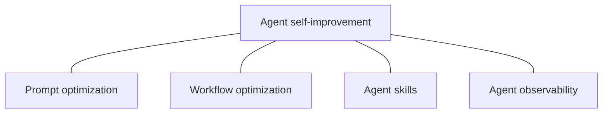

# Agent self-improvement map

**Status:** This map shows how topics in the corpus relate to one another. Its edges represent conceptual links and carry no claim of experimental causality.

## Concept map

## Concepts and papers

### [Agent self-improvement](../concepts/self-evolution.md)

- [Harness-of-Harness: Multi-Day Autonomous Software Development with Continual Improvement](../sources/arxiv-2609.01481.md)
- [Trial by Trace: Benchmarking AI Agent Harnesses for Reliability and Failure Attribution](../sources/arxiv-2610.32285.md)
- [Promptbreeder: Self-Referential Self-Improvement Via Prompt Evolution](../sources/arxiv-2309.16797.md)
- [DSPy: Compiling Declarative Language Model Calls into Self-Improving Pipelines](../sources/arxiv-2310.03714.md)
- [MemSkill: Learning and Evolving Memory Skills for Self-Evolving Agents](../sources/arxiv-2602.02474.md)
- [Reflexion: Language Agents with Verbal Reinforcement Learning](../sources/arxiv-2303.11366.md)
- [Darwin Gödel Machine: Open-Ended Evolution of Self-Improving Agents](../sources/arxiv-2505.22954.md)

### [Prompt optimization](../concepts/prompt-optimization.md)

- [Self-Refine: Iterative Refinement with Self-Feedback](../sources/arxiv-2303.17651.md)
- [InjecAgent: Benchmarking Indirect Prompt Injections in Tool-Integrated Large Language Model Agents](../sources/arxiv-2403.02691.md)
- [DocPrompting: Generating Code by Retrieving the Docs](../sources/arxiv-2207.05987.md)
- [Code Generation with AlphaCodium: From Prompt Engineering to Flow Engineering](../sources/arxiv-2401.08500.md)
- [AgentDojo: A Dynamic Environment to Evaluate Prompt Injection Attacks and Defenses for LLM Agents](../sources/arxiv-2406.13352.md)
- [Assessing Automated Prompt Injection Attacks in Agentic Environments](../sources/arxiv-2606.10525.md)
- [Large Language Models Are Human-Level Prompt Engineers](../sources/arxiv-2211.01910.md)

### [Workflow optimization](../concepts/workflow-optimization.md)

- [AgentCoder: Multi-Agent-based Code Generation with Iterative Testing and Optimisation](../sources/arxiv-2312.13010.md)
- [Self-Refine: Iterative Refinement with Self-Feedback](../sources/arxiv-2303.17651.md)
- [Code Generation with AlphaCodium: From Prompt Engineering to Flow Engineering](../sources/arxiv-2401.08500.md)
- [Large Language Models Are Human-Level Prompt Engineers](../sources/arxiv-2211.01910.md)
- [Large Language Models as Optimizers](../sources/arxiv-2309.03409.md)
- [Promptbreeder: Self-Referential Self-Improvement Via Prompt Evolution](../sources/arxiv-2309.16797.md)
- [DSPy: Compiling Declarative Language Model Calls into Self-Improving Pipelines](../sources/arxiv-2310.03714.md)

### [Agent skills](../concepts/agent-skills.md)

- [Voyager: An Open-Ended Embodied Agent with Large Language Models](../sources/arxiv-2305.16291.md)
- [MemSkill: Learning and Evolving Memory Skills for Self-Evolving Agents](../sources/arxiv-2602.02474.md)
- [EvoSkill: Automated Skill Discovery for Multi-Agent Systems](../sources/arxiv-2603.02766.md)
- [Socratic-SWE: Self-Evolving Coding Agents via Trace-Derived Agent Skills](../sources/arxiv-2606.07412.md)
- [FlowEvo: Self-Evolving Agents through the Co-Evolution of Workflows and Executable Skills](../sources/arxiv-2607.21596.md)
- [Evo-Harness: Context-to-Harness Skill Compilation for Self-Evolving Agents](../sources/arxiv-2608.15071.md)
- [Evolving to Match Capabilities: Improving Harness Self-Evolution via Skill Adaptation](../sources/arxiv-2610.33024.md)

### [Agent observability](../concepts/observability.md)

- [Agentless: Demystifying LLM-based Software Engineering Agents](../sources/arxiv-2407.01489.md)
- [Debugging the Debuggers: Failure-Anchored Structured Recovery for Software Engineering Agents](../sources/arxiv-2605.08717.md)
- [TRAJDEBUG: Tracing Error Lifecycle to Identify Critical Failures in Long-Horizon Agent Trajectories](../sources/arxiv-2608.06346.md)
- [TRACE: A Framework for Analyzing and Enhancing Stepwise Reasoning in Vision-Language Models](../sources/arxiv-2512.05943.md)
- [Trial by Trace: Benchmarking AI Agent Harnesses for Reliability and Failure Attribution](../sources/arxiv-2610.32285.md)
- [AgentDojo: A Dynamic Environment to Evaluate Prompt Injection Attacks and Defenses for LLM Agents](../sources/arxiv-2406.13352.md)
- [Detecting Safety Violations Across Many Agent Traces](../sources/arxiv-2604.11806.md)

