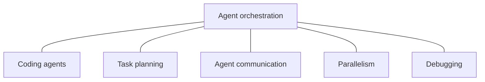

# Coding agents map

**Status:** This map shows how topics in the corpus relate to one another. Its edges represent conceptual links and carry no claim of experimental causality.

## Concept map

## Concepts and papers

### [Agent orchestration](../concepts/agent-orchestration.md)

- [AgentCoder: Multi-Agent-based Code Generation with Iterative Testing and Optimisation](../sources/arxiv-2312.13010.md)
- [SWE-agent: Agent-Computer Interfaces Enable Automated Software Engineering](../sources/arxiv-2405.15793.md)
- [Agentless: Demystifying LLM-based Software Engineering Agents](../sources/arxiv-2407.01489.md)
- [SWE-Search: Enhancing Software Agents with Monte Carlo Tree Search and Iterative Refinement](../sources/arxiv-2410.20285.md)
- [Where LLM Agents Fail and How They can Learn From Failures](../sources/arxiv-2509.25370.md)
- [The OpenHands Software Agent SDK: A Composable and Extensible Foundation for Production Agents](../sources/arxiv-2511.03690.md)
- [SWE-Adept: An LLM-Based Agentic Framework for Deep Codebase Analysis and Structured Issue Resolution](../sources/arxiv-2603.01327.md)

### [Coding agents](../concepts/coding-agents.md)

- [AgentCoder: Multi-Agent-based Code Generation with Iterative Testing and Optimisation](../sources/arxiv-2312.13010.md)
- [AutoCodeRover: Autonomous Program Improvement](../sources/arxiv-2404.05427.md)
- [SWE-agent: Agent-Computer Interfaces Enable Automated Software Engineering](../sources/arxiv-2405.15793.md)
- [Agentless: Demystifying LLM-based Software Engineering Agents](../sources/arxiv-2407.01489.md)
- [SWE-Search: Enhancing Software Agents with Monte Carlo Tree Search and Iterative Refinement](../sources/arxiv-2410.20285.md)
- [Where LLM Agents Fail and How They can Learn From Failures](../sources/arxiv-2509.25370.md)
- [The OpenHands Software Agent SDK: A Composable and Extensible Foundation for Production Agents](../sources/arxiv-2511.03690.md)

### [Task planning](../concepts/task-planning.md)

- [SWE-Adept: An LLM-Based Agentic Framework for Deep Codebase Analysis and Structured Issue Resolution](../sources/arxiv-2603.01327.md)
- [Harness-of-Harness: Multi-Day Autonomous Software Development with Continual Improvement](../sources/arxiv-2609.01481.md)
- [RoadmapBench: Evaluating Long-Horizon Agentic Software Development Across Version Upgrades](../sources/arxiv-2605.15846.md)
- [ReAct: Synergizing Reasoning and Acting in Language Models](../sources/arxiv-2210.03629.md)
- [Toolformer: Language Models Can Teach Themselves to Use Tools](../sources/arxiv-2302.04761.md)
- [CAMEL: Communicative Agents for "Mind" Exploration of Large Language Model Society](../sources/arxiv-2303.17760.md)
- [Generative Agents: Interactive Simulacra of Human Behavior](../sources/arxiv-2304.03442.md)

### [Agent communication](../concepts/agent-communication.md)

- [CAMEL: Communicative Agents for "Mind" Exploration of Large Language Model Society](../sources/arxiv-2303.17760.md)
- [ChatDev: Communicative Agents for Software Development](../sources/arxiv-2307.07924.md)
- [MetaGPT: Meta Programming for A Multi-Agent Collaborative Framework](../sources/arxiv-2308.00352.md)
- [CodeTeam: An LLM-Powered Multi-Agent Framework for Repository-Level Code Generation](../sources/arxiv-2606.22082.md)
- [Decentralized Multi-Agent Coordination and Communication in Shared Codebases](../sources/arxiv-2611.00314.md)

### [Parallelism](../concepts/parallelism.md)

- [An LLM Compiler for Parallel Function Calling](../sources/arxiv-2312.04511.md)
- [Effective Strategies for Asynchronous Software Engineering Agents](../sources/arxiv-2603.21489.md)
- [Decentralized Multi-Agent Coordination and Communication in Shared Codebases](../sources/arxiv-2611.00314.md)
- [SquirrelFS: Using the Rust Compiler to Check File-System Crash Consistency](../sources/arxiv-2406.09649.md)

### [Debugging](../concepts/debugging.md)

- [AgentCoder: Multi-Agent-based Code Generation with Iterative Testing and Optimisation](../sources/arxiv-2312.13010.md)
- [AutoCodeRover: Autonomous Program Improvement](../sources/arxiv-2404.05427.md)
- [SWE-agent: Agent-Computer Interfaces Enable Automated Software Engineering](../sources/arxiv-2405.15793.md)
- [Agentless: Demystifying LLM-based Software Engineering Agents](../sources/arxiv-2407.01489.md)
- [SWE-Search: Enhancing Software Agents with Monte Carlo Tree Search and Iterative Refinement](../sources/arxiv-2410.20285.md)
- [Where LLM Agents Fail and How They can Learn From Failures](../sources/arxiv-2509.25370.md)
- [The OpenHands Software Agent SDK: A Composable and Extensible Foundation for Production Agents](../sources/arxiv-2511.03690.md)

