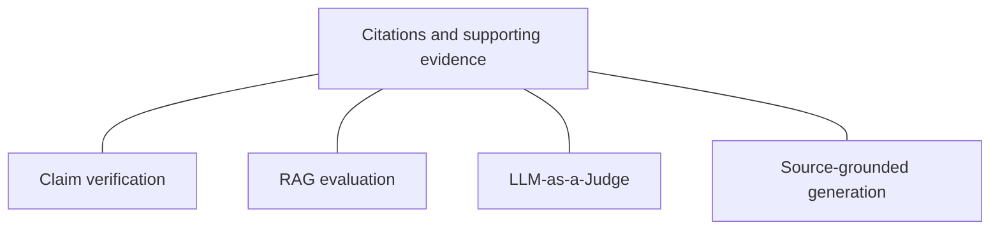

# Evidence and reliability map

**Status:** This map shows how topics in the corpus relate to one another. Its edges represent conceptual links and carry no claim of experimental causality.

## Concept map

## Concepts and papers

### [Citations and supporting evidence](../concepts/citation-grounding.md)

- [KILT: a Benchmark for Knowledge Intensive Language Tasks](../sources/arxiv-2009.02252.md)
- [Enabling Large Language Models to Generate Text with Citations](../sources/arxiv-2305.14627.md)
- [Prometheus 2: An Open Source Language Model Specialized in Evaluating Other Language Models](../sources/arxiv-2405.01535.md)
- [Fact or Fiction: Verifying Scientific Claims](../sources/arxiv-2004.14974.md)
- [G-Eval: NLG Evaluation using GPT-4 with Better Human Alignment](../sources/arxiv-2303.16634.md)
- [FActScore: Fine-grained Atomic Evaluation of Factual Precision in Long Form Text Generation](../sources/arxiv-2305.14251.md)
- [Chain-of-Verification Reduces Hallucination in Large Language Models](../sources/arxiv-2309.11495.md)

### [Claim verification](../concepts/claim-verification.md)

- [Debugging the Debuggers: Failure-Anchored Structured Recovery for Software Engineering Agents](../sources/arxiv-2605.08717.md)
- [TRAJDEBUG: Tracing Error Lifecycle to Identify Critical Failures in Long-Horizon Agent Trajectories](../sources/arxiv-2608.06346.md)
- [RAGChecker: A Fine-grained Framework for Diagnosing Retrieval-Augmented Generation](../sources/arxiv-2408.08067.md)
- [EvoSkill: Automated Skill Discovery for Multi-Agent Systems](../sources/arxiv-2603.02766.md)
- [Fact or Fiction: Verifying Scientific Claims](../sources/arxiv-2004.14974.md)
- [FActScore: Fine-grained Atomic Evaluation of Factual Precision in Long Form Text Generation](../sources/arxiv-2305.14251.md)
- [Long-form factuality in large language models](../sources/arxiv-2403.18802.md)

### [RAG evaluation](../concepts/rag-evaluation.md)

- [Can Large Language Models Resolve Real Java Merge Conflicts? An Evaluation with a Calibrated LLM-as-Judge](../sources/arxiv-2607.27674.md)
- [ToolSandbox: A Stateful, Conversational, Interactive Evaluation Benchmark for LLM Tool Use Capabilities](../sources/arxiv-2408.04682.md)
- [SWE-PolyBench: A Multi-Language Benchmark for Repository-Level Evaluation of Coding Agents](../sources/arxiv-2504.08703.md)
- [NL2Repo-Bench: Towards Long-Horizon Repository Generation Evaluation of Coding Agents](../sources/arxiv-2512.12730.md)
- [AgentLens: Revealing The Lucky Pass Problem in SWE-Agent Evaluation](../sources/arxiv-2605.12925.md)
- [RoadmapBench: Evaluating Long-Horizon Agentic Software Development Across Version Upgrades](../sources/arxiv-2605.15846.md)
- [AgentLens: Production-Assessed Trajectory Reviews for Coding Agent Evaluation](../sources/arxiv-2607.06624.md)

### [LLM-as-a-Judge](../concepts/llm-as-judge.md)

- [Can Large Language Models Resolve Real Java Merge Conflicts? An Evaluation with a Calibrated LLM-as-Judge](../sources/arxiv-2607.27674.md)
- [ToolSandbox: A Stateful, Conversational, Interactive Evaluation Benchmark for LLM Tool Use Capabilities](../sources/arxiv-2408.04682.md)
- [SWE-PolyBench: A Multi-Language Benchmark for Repository-Level Evaluation of Coding Agents](../sources/arxiv-2504.08703.md)
- [NL2Repo-Bench: Towards Long-Horizon Repository Generation Evaluation of Coding Agents](../sources/arxiv-2512.12730.md)
- [AgentLens: Revealing The Lucky Pass Problem in SWE-Agent Evaluation](../sources/arxiv-2605.12925.md)
- [RoadmapBench: Evaluating Long-Horizon Agentic Software Development Across Version Upgrades](../sources/arxiv-2605.15846.md)
- [AgentLens: Production-Assessed Trajectory Reviews for Coding Agent Evaluation](../sources/arxiv-2607.06624.md)

### [Source-grounded generation](../concepts/grounded-generation.md)

- [Sentence-BERT: Sentence Embeddings using Siamese BERT-Networks](../sources/arxiv-1908.10084.md)
- [Dense Passage Retrieval for Open-Domain Question Answering](../sources/arxiv-2004.04906.md)
- [Retrieval-Augmented Generation for Knowledge-Intensive NLP Tasks](../sources/arxiv-2005.11401.md)
- [ColBERTv2: Effective and Efficient Retrieval via Lightweight Late Interaction](../sources/arxiv-2112.01488.md)
- [Precise Zero-Shot Dense Retrieval without Relevance Labels](../sources/arxiv-2212.10496.md)
- [Active Retrieval Augmented Generation](../sources/arxiv-2305.06983.md)
- [Retrieval-Augmented Generation for Large Language Models: A Survey](../sources/arxiv-2312.10997.md)

