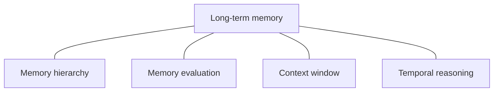

# Knowledge and memory map

**Status:** This map shows how topics in the corpus relate to one another. Its edges represent conceptual links and carry no claim of experimental causality.

## Concept map

## Concepts and papers

### [Long-term memory](../concepts/long-term-memory.md)

- [Voyager: An Open-Ended Embodied Agent with Large Language Models](../sources/arxiv-2305.16291.md)
- [A-MEM: Agentic Memory for LLM Agents](../sources/arxiv-2502.12110.md)
- [Mem0: Building Production-Ready AI Agents with Scalable Long-Term Memory](../sources/arxiv-2504.19413.md)
- [MemSkill: Learning and Evolving Memory Skills for Self-Evolving Agents](../sources/arxiv-2602.02474.md)
- [Agent Memory: Characterization and System Implications of Stateful Long-Horizon Workloads](../sources/arxiv-2606.06448.md)
- [SWE-MeM: Learning Adaptive Memory Management for Long-Horizon Coding Agents](../sources/arxiv-2606.28434.md)
- [Lost in the Middle: How Language Models Use Long Contexts](../sources/arxiv-2307.03172.md)

### [Memory hierarchy](../concepts/memory-hierarchy.md)

- [MemGPT: Towards LLMs as Operating Systems](../sources/arxiv-2310.08560.md)
- [RAPTOR: Recursive Abstractive Processing for Tree-Organized Retrieval](../sources/arxiv-2401.18059.md)
- [Autonomous Deep Agent](../sources/arxiv-2502.07056.md)

### [Memory evaluation](../concepts/memory-evaluation.md)

- [A-MEM: Agentic Memory for LLM Agents](../sources/arxiv-2502.12110.md)
- [Mem0: Building Production-Ready AI Agents with Scalable Long-Term Memory](../sources/arxiv-2504.19413.md)
- [MemSkill: Learning and Evolving Memory Skills for Self-Evolving Agents](../sources/arxiv-2602.02474.md)
- [Agent Memory: Characterization and System Implications of Stateful Long-Horizon Workloads](../sources/arxiv-2606.06448.md)
- [SWE-MeM: Learning Adaptive Memory Management for Long-Horizon Coding Agents](../sources/arxiv-2606.28434.md)
- [Evaluating Very Long-Term Conversational Memory of LLM Agents](../sources/arxiv-2402.17753.md)
- [HippoRAG: Neurobiologically Inspired Long-Term Memory for Large Language Models](../sources/arxiv-2405.14831.md)

### [Context window](../concepts/context-window.md)

- [TRAJDEBUG: Tracing Error Lifecycle to Identify Critical Failures in Long-Horizon Agent Trajectories](../sources/arxiv-2608.06346.md)
- [NL2Repo-Bench: Towards Long-Horizon Repository Generation Evaluation of Coding Agents](../sources/arxiv-2512.12730.md)
- [SlopCodeBench: Benchmarking How Coding Agents Degrade Over Long-Horizon Iterative Tasks](../sources/arxiv-2603.24755.md)
- [RoadmapBench: Evaluating Long-Horizon Agentic Software Development Across Version Upgrades](../sources/arxiv-2605.15846.md)
- [SaaSBench: Exploring the Boundaries of Coding Agents in Long-Horizon Enterprise SaaS Engineering](../sources/arxiv-2605.17526.md)
- [SpecBench: Measuring Reward Hacking in Long-Horizon Coding Agents](../sources/arxiv-2605.21384.md)
- [DeepSWE: Measuring Frontier Coding Agents on Original, Long-Horizon Engineering Tasks](../sources/arxiv-2607.07946.md)

### [Temporal reasoning](../concepts/temporal-reasoning.md)

- [SWE-Doctor: Guiding Software Engineering Agents with Runtime Diagnosis from Multi-Faceted Bug Reproduction Tests](../sources/arxiv-2607.00990.md)
- [RoadmapBench: Evaluating Long-Horizon Agentic Software Development Across Version Upgrades](../sources/arxiv-2605.15846.md)
- [Large Language Models as Optimizers](../sources/arxiv-2309.03409.md)
- [LongMemEval: Benchmarking Chat Assistants on Long-Term Interactive Memory](../sources/arxiv-2410.10813.md)

