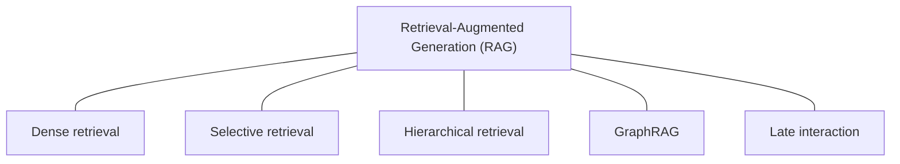

# Retrieval and RAG map

**Status:** This map shows how topics in the corpus relate to one another. Its edges represent conceptual links and carry no claim of experimental causality.

## Concept map

## Concepts and papers

### [Retrieval-Augmented Generation (RAG)](../concepts/retrieval-augmented-generation.md)

- [Sentence-BERT: Sentence Embeddings using Siamese BERT-Networks](../sources/arxiv-1908.10084.md)
- [Dense Passage Retrieval for Open-Domain Question Answering](../sources/arxiv-2004.04906.md)
- [Retrieval-Augmented Generation for Knowledge-Intensive NLP Tasks](../sources/arxiv-2005.11401.md)
- [ColBERTv2: Effective and Efficient Retrieval via Lightweight Late Interaction](../sources/arxiv-2112.01488.md)
- [Precise Zero-Shot Dense Retrieval without Relevance Labels](../sources/arxiv-2212.10496.md)
- [Active Retrieval Augmented Generation](../sources/arxiv-2305.06983.md)
- [Retrieval-Augmented Generation for Large Language Models: A Survey](../sources/arxiv-2312.10997.md)

### [Dense retrieval](../concepts/dense-retrieval.md)

- [Sentence-BERT: Sentence Embeddings using Siamese BERT-Networks](../sources/arxiv-1908.10084.md)
- [Dense Passage Retrieval for Open-Domain Question Answering](../sources/arxiv-2004.04906.md)
- [Precise Zero-Shot Dense Retrieval without Relevance Labels](../sources/arxiv-2212.10496.md)
- [ColPali: Efficient Document Retrieval with Vision Language Models](../sources/arxiv-2407.01449.md)

### [Selective retrieval](../concepts/selective-retrieval.md)

- [Active Retrieval Augmented Generation](../sources/arxiv-2305.06983.md)
- [Repoformer: Selective Retrieval for Repository-Level Code Completion](../sources/arxiv-2403.10059.md)
- [Self-RAG: Learning to Retrieve, Generate, and Critique through Self-Reflection](../sources/arxiv-2310.11511.md)

### [Hierarchical retrieval](../concepts/hierarchical-retrieval.md)

- [MemGPT: Towards LLMs as Operating Systems](../sources/arxiv-2310.08560.md)
- [RAPTOR: Recursive Abstractive Processing for Tree-Organized Retrieval](../sources/arxiv-2401.18059.md)
- [Autonomous Deep Agent](../sources/arxiv-2502.07056.md)

### [GraphRAG](../concepts/graph-rag.md)

- [From Local to Global: A Graph RAG Approach to Query-Focused Summarization](../sources/arxiv-2404.16130.md)
- [HippoRAG: Neurobiologically Inspired Long-Term Memory for Large Language Models](../sources/arxiv-2405.14831.md)
- [LightRAG: Simple and Fast Retrieval-Augmented Generation](../sources/arxiv-2410.05779.md)

### [Late interaction](../concepts/late-interaction.md)

- [ColBERTv2: Effective and Efficient Retrieval via Lightweight Late Interaction](../sources/arxiv-2112.01488.md)
- [ColPali: Efficient Document Retrieval with Vision Language Models](../sources/arxiv-2407.01449.md)

