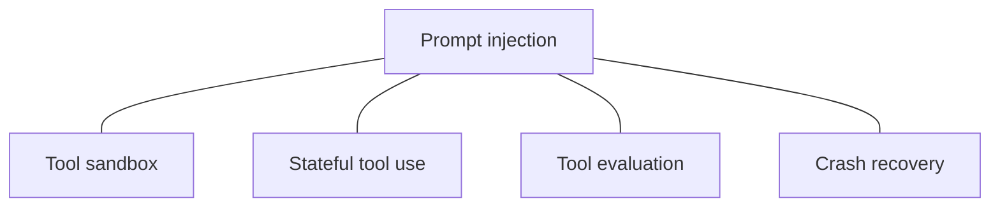

# Agent security map

**Status:** This map shows how topics in the corpus relate to one another. Its edges represent conceptual links and carry no claim of experimental causality.

## Concept map

## Concepts and papers

### [Prompt injection](../concepts/prompt-injection.md)

- [InjecAgent: Benchmarking Indirect Prompt Injections in Tool-Integrated Large Language Model Agents](../sources/arxiv-2403.02691.md)
- [AgentDojo: A Dynamic Environment to Evaluate Prompt Injection Attacks and Defenses for LLM Agents](../sources/arxiv-2406.13352.md)
- [Assessing Automated Prompt Injection Attacks in Agentic Environments](../sources/arxiv-2606.10525.md)
- [Observability and Fault Injection for LLM-Based Multi-Agent Systems in Software Engineering](../sources/arxiv-2608.24271.md)

### [Tool sandbox](../concepts/tool-sandboxing.md)

- [ToolLLM: Facilitating Large Language Models to Master 16000+ Real-world APIs](../sources/arxiv-2307.16789.md)
- [Mixture-of-Agents Enhances Large Language Model Capabilities](../sources/arxiv-2406.04692.md)
- [WebArena: A Realistic Web Environment for Building Autonomous Agents](../sources/arxiv-2307.13854.md)
- [Identifying the Risks of LM Agents with an LM-Emulated Sandbox](../sources/arxiv-2309.15817.md)
- [InjecAgent: Benchmarking Indirect Prompt Injections in Tool-Integrated Large Language Model Agents](../sources/arxiv-2403.02691.md)
- [OSWorld: Benchmarking Multimodal Agents for Open-Ended Tasks in Real Computer Environments](../sources/arxiv-2404.07972.md)
- [$\tau$-bench: A Benchmark for Tool-Agent-User Interaction in Real-World Domains](../sources/arxiv-2406.12045.md)

### [Stateful tool use](../concepts/stateful-tool-use.md)

- [ToolLLM: Facilitating Large Language Models to Master 16000+ Real-world APIs](../sources/arxiv-2307.16789.md)
- [Mixture-of-Agents Enhances Large Language Model Capabilities](../sources/arxiv-2406.04692.md)
- [Identifying the Risks of LM Agents with an LM-Emulated Sandbox](../sources/arxiv-2309.15817.md)
- [InjecAgent: Benchmarking Indirect Prompt Injections in Tool-Integrated Large Language Model Agents](../sources/arxiv-2403.02691.md)
- [$\tau$-bench: A Benchmark for Tool-Agent-User Interaction in Real-World Domains](../sources/arxiv-2406.12045.md)
- [ToolSandbox: A Stateful, Conversational, Interactive Evaluation Benchmark for LLM Tool Use Capabilities](../sources/arxiv-2408.04682.md)
- [AppWorld: A Controllable World of Apps and People for Benchmarking Interactive Coding Agents](../sources/arxiv-2407.18901.md)

### [Tool evaluation](../concepts/tool-evaluation.md)

- [ToolLLM: Facilitating Large Language Models to Master 16000+ Real-world APIs](../sources/arxiv-2307.16789.md)
- [Mixture-of-Agents Enhances Large Language Model Capabilities](../sources/arxiv-2406.04692.md)
- [Identifying the Risks of LM Agents with an LM-Emulated Sandbox](../sources/arxiv-2309.15817.md)
- [InjecAgent: Benchmarking Indirect Prompt Injections in Tool-Integrated Large Language Model Agents](../sources/arxiv-2403.02691.md)
- [$\tau$-bench: A Benchmark for Tool-Agent-User Interaction in Real-World Domains](../sources/arxiv-2406.12045.md)
- [ToolSandbox: A Stateful, Conversational, Interactive Evaluation Benchmark for LLM Tool Use Capabilities](../sources/arxiv-2408.04682.md)
- [AppWorld: A Controllable World of Apps and People for Benchmarking Interactive Coding Agents](../sources/arxiv-2407.18901.md)

### [Crash recovery](../concepts/fault-recovery.md)

- [Where LLM Agents Fail and How They can Learn From Failures](../sources/arxiv-2509.25370.md)
- [Debugging the Debuggers: Failure-Anchored Structured Recovery for Software Engineering Agents](../sources/arxiv-2605.08717.md)
- [TRAJDEBUG: Tracing Error Lifecycle to Identify Critical Failures in Long-Horizon Agent Trajectories](../sources/arxiv-2608.06346.md)
- [When Agent Evaluation Becomes Unreliable: An Empirical Study of Oracle Failures and Configuration-Dependent Measurement in an LLM Agent Benchmark](../sources/arxiv-2610.16067.md)
- [Trial by Trace: Benchmarking AI Agent Harnesses for Reliability and Failure Attribution](../sources/arxiv-2610.32285.md)
- [Observability and Fault Injection for LLM-Based Multi-Agent Systems in Software Engineering](../sources/arxiv-2608.24271.md)
- [From Failed Trajectories to Reliable LLM Agents: Diagnosing and Repairing Harness Flaws](../sources/arxiv-2606.06324.md)

