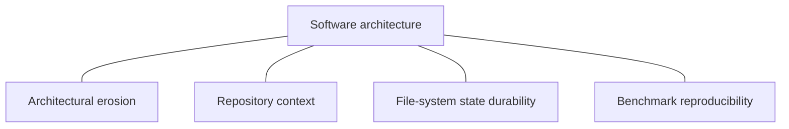

# Software architecture map

**Status:** This map shows how topics in the corpus relate to one another. Its edges represent conceptual links and carry no claim of experimental causality.

## Concept map

## Concepts and papers

### [Software architecture](../concepts/architecture-design.md)

- [The OpenHands Software Agent SDK: A Composable and Extensible Foundation for Production Agents](../sources/arxiv-2511.03690.md)
- [Retrieval-Augmented Generation for Large Language Models: A Survey](../sources/arxiv-2312.10997.md)
- [Automated Design of Agentic Systems](../sources/arxiv-2408.08435.md)
- [Multi-agent Architecture Search via Agentic Supernet](../sources/arxiv-2502.04180.md)
- [Inside the Scaffold: A Source-Code Taxonomy of Coding Agent Architectures](../sources/arxiv-2604.03515.md)

### [Architectural erosion](../concepts/architecture-erosion.md)

- [SlopCodeBench: Benchmarking How Coding Agents Degrade Over Long-Horizon Iterative Tasks](../sources/arxiv-2603.24755.md)
- [SWE-NFI: Studying and Benchmarking Coding Agents for Non-Functional Improvements](../sources/arxiv-2607.27409.md)

### [Repository context](../concepts/repository-context.md)

- [SWE-Adept: An LLM-Based Agentic Framework for Deep Codebase Analysis and Structured Issue Resolution](../sources/arxiv-2603.01327.md)
- [RepoBench: Benchmarking Repository-Level Code Auto-Completion Systems](../sources/arxiv-2306.03091.md)
- [SWE-bench: Can Language Models Resolve Real-World GitHub Issues?](../sources/arxiv-2310.06770.md)
- [SWE-PolyBench: A Multi-Language Benchmark for Repository-Level Evaluation of Coding Agents](../sources/arxiv-2504.08703.md)
- [SetupBench: Assessing Software Engineering Agents' Ability to Bootstrap Development Environments](../sources/arxiv-2507.09063.md)
- [NL2Repo-Bench: Towards Long-Horizon Repository Generation Evaluation of Coding Agents](../sources/arxiv-2512.12730.md)
- [RepoZero: Can LLMs Generate a Code Repository from Scratch?](../sources/arxiv-2605.07122.md)

### [File-system state durability](../concepts/file-system-durability.md)

- [Finding Crash-Consistency Bugs with Bounded Black-Box Crash Testing](../sources/arxiv-1810.02904.md)
- [DurableFS: A File System for Persistent Memory](../sources/arxiv-1811.00757.md)
- [Finding and Analyzing Crash-Consistency Bugs in Persistent-Memory File Systems](../sources/arxiv-2204.06066.md)
- [The Path to Durable Linearizability](../sources/arxiv-2211.07631.md)
- [SquirrelFS: Using the Rust Compiler to Check File-System Crash Consistency](../sources/arxiv-2406.09649.md)
- [Scalable and Accurate Application-Level Crash-Consistency Testing via Representative Testing](../sources/arxiv-2503.01390.md)

### [Benchmark reproducibility](../concepts/comparison-and-reproducibility.md)

- [SWE-Doctor: Guiding Software Engineering Agents with Runtime Diagnosis from Multi-Faceted Bug Reproduction Tests](../sources/arxiv-2607.00990.md)
- [Can Large Language Models Resolve Real Java Merge Conflicts? An Evaluation with a Calibrated LLM-as-Judge](../sources/arxiv-2607.27674.md)
- [WebArena: A Realistic Web Environment for Building Autonomous Agents](../sources/arxiv-2307.13854.md)
- [Identifying the Risks of LM Agents with an LM-Emulated Sandbox](../sources/arxiv-2309.15817.md)
- [InjecAgent: Benchmarking Indirect Prompt Injections in Tool-Integrated Large Language Model Agents](../sources/arxiv-2403.02691.md)
- [OSWorld: Benchmarking Multimodal Agents for Open-Ended Tasks in Real Computer Environments](../sources/arxiv-2404.07972.md)
- [$\tau$-bench: A Benchmark for Tool-Agent-User Interaction in Real-World Domains](../sources/arxiv-2406.12045.md)

