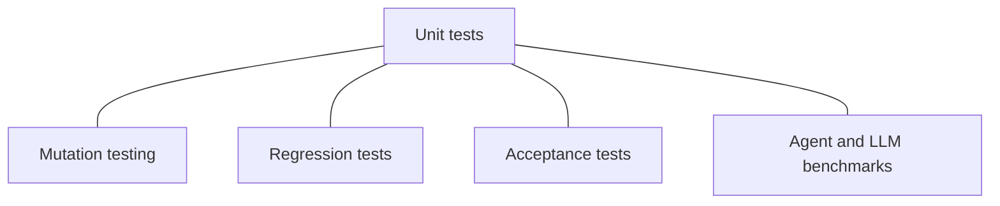

# Testing and validation map

**Status:** This map shows how topics in the corpus relate to one another. Its edges represent conceptual links and carry no claim of experimental causality.

## Concept map

## How to interpret a passing test

- **Task outcomes and process quality.** AgentLens classified 122 of 1,136 successful runs as Lucky Passes. Fifteen of those runs used a valid alternative strategy. [Table 23](https://arxiv.org/pdf/2605.12925v5#page=35)
- **Task outcomes and harness behavior.** In TraceTrial-Bench, 1,065 of 3,420 runs completed the task despite failing at least one harness criterion. [Table 10](https://arxiv.org/pdf/2610.32285v1#page=19)
- **Consistency across repeated trials.** In τ-bench, pass^k requires success in all k attempts on the same task. For GPT-4o in retail, pass^1 was 61.2% and pass^8 fell below 25%. [Definition](https://arxiv.org/pdf/2406.12045v1#page=5) · [Table 2 and Figure 4](https://arxiv.org/pdf/2406.12045v1#page=7)

## Concepts and papers

### [Unit tests](../concepts/unit-testing.md)

- [AgentCoder: Multi-Agent-based Code Generation with Iterative Testing and Optimisation](../sources/arxiv-2312.13010.md)
- [DocPrompting: Generating Code by Retrieving the Docs](../sources/arxiv-2207.05987.md)
- [CodeT: Code Generation with Generated Tests](../sources/arxiv-2207.10397.md)
- [RepoCoder: Repository-Level Code Completion Through Iterative Retrieval and Generation](../sources/arxiv-2303.12570.md)
- [Code Generation with AlphaCodium: From Prompt Engineering to Flow Engineering](../sources/arxiv-2401.08500.md)
- [Automated Unit Test Improvement using Large Language Models at Meta](../sources/arxiv-2402.09171.md)
- [Repoformer: Selective Retrieval for Repository-Level Code Completion](../sources/arxiv-2403.10059.md)

### [Mutation testing](../concepts/mutation-testing.md)

- [Does mutation testing improve testing practices?](../sources/arxiv-2103.07189.md)

### [Regression tests](../concepts/regression-testing.md)

- [SWE-Chain: Benchmarking Coding Agents on Chained Release-Level Package Upgrades](../sources/arxiv-2605.14415.md)
- [RoadmapBench: Evaluating Long-Horizon Agentic Software Development Across Version Upgrades](../sources/arxiv-2605.15846.md)
- [Predictive Test Selection](../sources/arxiv-1810.05286.md)
- [Does mutation testing improve testing practices?](../sources/arxiv-2103.07189.md)
- [Fine-Grained Assertion-Based Test Selection](../sources/arxiv-2403.16001.md)

### [Acceptance tests](../concepts/acceptance-testing.md)

- [WebArena: A Realistic Web Environment for Building Autonomous Agents](../sources/arxiv-2307.13854.md)
- [AppWorld: A Controllable World of Apps and People for Benchmarking Interactive Coding Agents](../sources/arxiv-2407.18901.md)
- [FeatureBench: Benchmarking Agentic Coding for Complex Feature Development](../sources/arxiv-2602.10975.md)
- [SWE-INTERACT: Reimagining SWE Benchmarks as User-Driven Long-Horizon Coding Sessions](../sources/arxiv-2606.30573.md)

### [Agent and LLM benchmarks](../concepts/benchmarks.md)

- [AgentCoder: Multi-Agent-based Code Generation with Iterative Testing and Optimisation](../sources/arxiv-2312.13010.md)
- [SWE-agent: Agent-Computer Interfaces Enable Automated Software Engineering](../sources/arxiv-2405.15793.md)
- [SWE-Doctor: Guiding Software Engineering Agents with Runtime Diagnosis from Multi-Faceted Bug Reproduction Tests](../sources/arxiv-2607.00990.md)
- [Can Large Language Models Resolve Real Java Merge Conflicts? An Evaluation with a Calibrated LLM-as-Judge](../sources/arxiv-2607.27674.md)
- [Harness-of-Harness: Multi-Day Autonomous Software Development with Continual Improvement](../sources/arxiv-2609.01481.md)
- [ToolLLM: Facilitating Large Language Models to Master 16000+ Real-world APIs](../sources/arxiv-2307.16789.md)
- [WebArena: A Realistic Web Environment for Building Autonomous Agents](../sources/arxiv-2307.13854.md)

